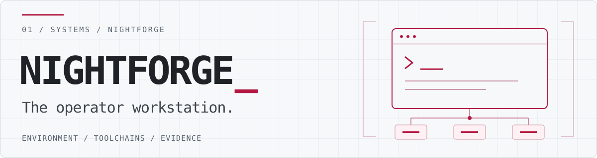

<picture>
  <source media="(prefers-color-scheme: dark)" srcset="assets/banner-dark.svg">
  <source media="(prefers-color-scheme: light)" srcset="assets/banner-light.svg">
  
</picture>

# NightForge

**The operator workstation. Security tooling and AI agents, in one reproducible environment.**

An [Omarchy](https://omarchy.org/)-based Arch Linux workstation bringing
version-controlled desktop configuration, rootless Podman toolchains, and the
TETHER monitoring harness together. Built for operators who want to inspect,
repeat, and validate their security workflows.

`Arch Linux` `Omarchy` `Podman` `Go` `CUE`

[Installation](docs/INSTALL.md) · [Architecture](ARCHITECTURE.md) · [Technical reference](docs/REFERENCE.md) · [CI](https://github.com/CR1MS0N-Operator/nightforge/actions)

## The workstation

### 01 / An environment you can inspect

Desktop and terminal configuration live beside package manifests and deployment
profiles. Hyprland / Omarchy configuration and Niri experiments are kept in the
repository; use the [system configuration guide](docs/SYSTEM-CONFIGURATION.md)
to choose what you deploy.

[Dotfiles](dotfiles/) · [Deployment profiles](docs/PROFILES.md) · [Operator terminal](docs/OPERATOR-TERMINAL.md)

### 02 / Toolchains with boundaries

Rootless Podman profiles separate general tooling, web testing, reverse
engineering, and Active Directory work. Explicit mounts and image export/import
support isolated and offline engagement workflows.

[Container guide](docs/CONTAINER.md) · [Container quick reference](docs/CONTAINER-QUICKREF.md) · [Manifests](manifests/)

### 03 / Evidence before changes

TETHER brings health, services, pipeline state, notifications, and usage into a
Go-backed dashboard. Harness scripts cover failure mining, proposals, gates,
and snapshots; the broader self-improving architecture remains a mix of
implementation and design, not a claim of autonomous remediation.

[Harness reference](docs/REFERENCE.md#tether-harness-control-plan) · [Pipeline scripts](scripts/harness/) · [Roadmap](docs/ROADMAP.md)

## Quick Start

NightForge targets an **Arch Linux / Omarchy workstation**. This is a
single-operator configuration repository, not a standalone Linux distribution.
Review the [installation guide](docs/INSTALL.md), [profiles](docs/PROFILES.md),
and manifests before applying host changes.

```bash
git clone https://github.com/\
CR1MS0N-Operator/nightforge.git
cd nightforge

# Preview packages only.
./install.sh \
  --profile solo-operator \
  --dry-run
```

After reviewing the plan, follow the installation guide to install packages,
apply dotfiles, and optionally build containers. The installer does not deploy
dotfiles itself.

### TETHER Harness Control Plan

To build the dashboard separately, use a Go toolchain compatible with
[go.mod](go.mod):

```bash
go build ./cmd/harnessd/
./harnessd
```

Open the address printed at startup. See [configuration](internal/config/config.go)
for defaults and the JSON configuration file, and the
[API and data reference](docs/REFERENCE.md#api) for the served routes.
Host telemetry depends on workstation services and local data; a build alone
does not provision them.

## Architecture Overview

| Layer | Role and guide |
|-------|----------------|
| Desktop | Shell, themes, and terminal. [Configuration](docs/SYSTEM-CONFIGURATION.md) |
| Toolchains | Rootless tooling. [Containers](docs/CONTAINER.md) |
| Harness | Dashboard and evidence. [Reference](docs/REFERENCE.md) |
| Host metrics | Prometheus and Grafana. [Stack guide](10-layer-stack/README.md) |

The host-metrics stack is optional and is not started automatically. Trace/LLM
observability runs outside this repository; the retired duplicate Langfuse and
OTel services are not part of the current stack.

## Below the surface

- **[Technical reference](docs/REFERENCE.md)** — TETHER API, data layout, pipelines, CUE migration, and historical benchmarks.
- **[Architecture](ARCHITECTURE.md)** — System design and two-stack TETHER model.
- **[Troubleshooting](TROUBLESHOOTING.md)** — Desktop, containers, terminal, theming, and network issues.
- **[Changelog](CHANGELOG.md)** — Change history; this repository follows a rolling model.
- **[Contributing](CONTRIBUTING.md)** — Development workflow and validation commands.
- **[Security policy](SECURITY.md)** — Reporting issues and repository security practices.

## In the wider system

Built by [CR1MS0N-Operator](https://github.com/CR1MS0N-Operator), alongside
[C4](https://github.com/CR1MS0N-Operator/c4) for infrastructure orchestration,
[Lant3rn](https://github.com/CR1MS0N-Operator/Lant3rn) for directory-permission
auditing, and [security research](https://github.com/CR1MS0N-Operator/security-research)
for the analysis behind the tooling.

---

<sub>Reproducible environments. Inspectable tooling. Evidence before changes.</sub>

For authorized security research and engagement work. Sensitive configuration
and live operational details are intentionally excluded. [MIT license](LICENSE).
